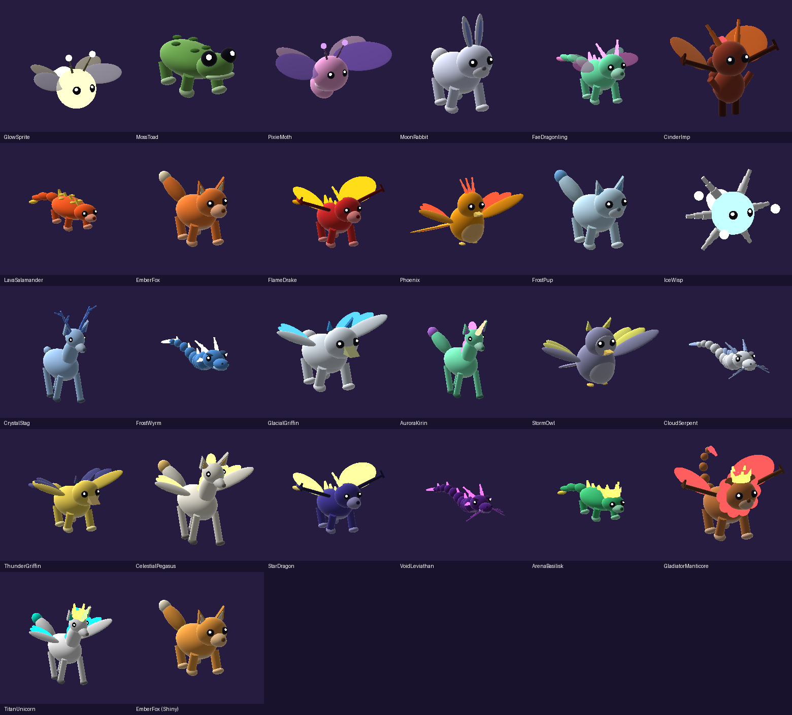
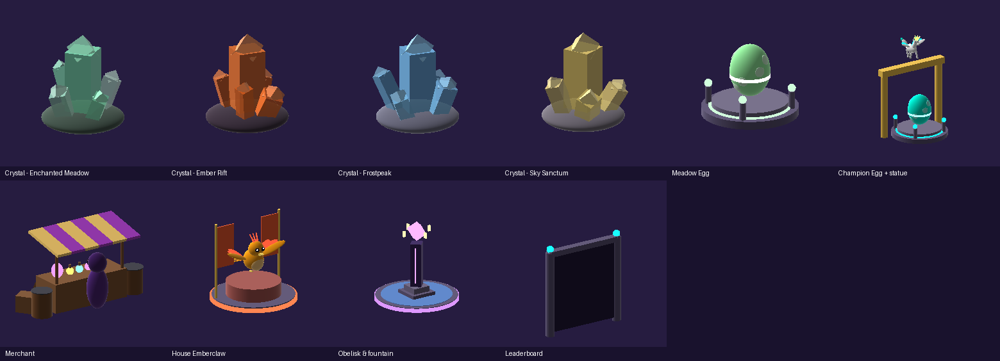
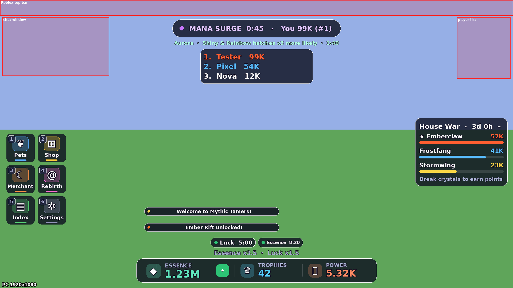
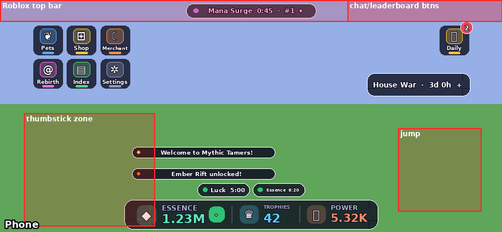
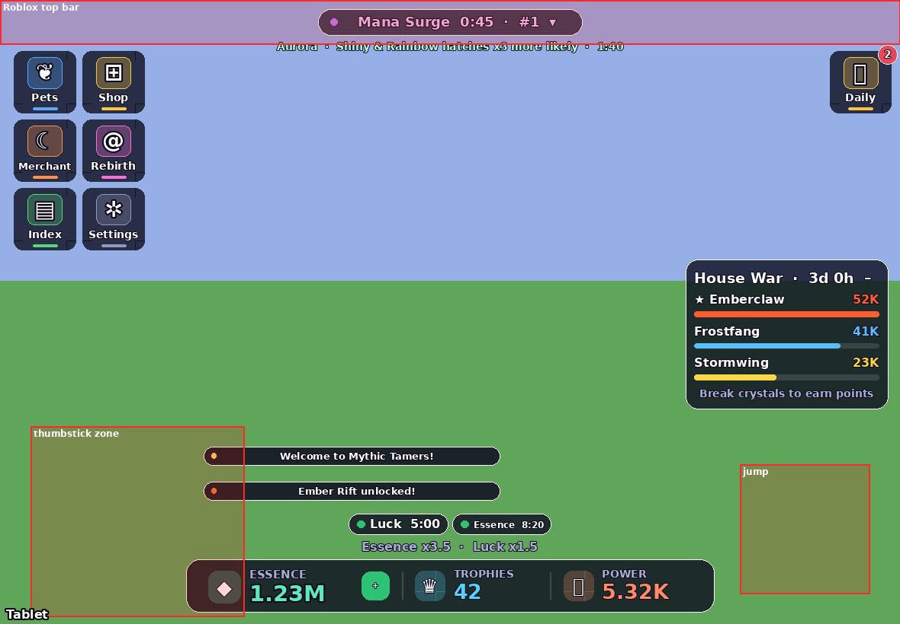
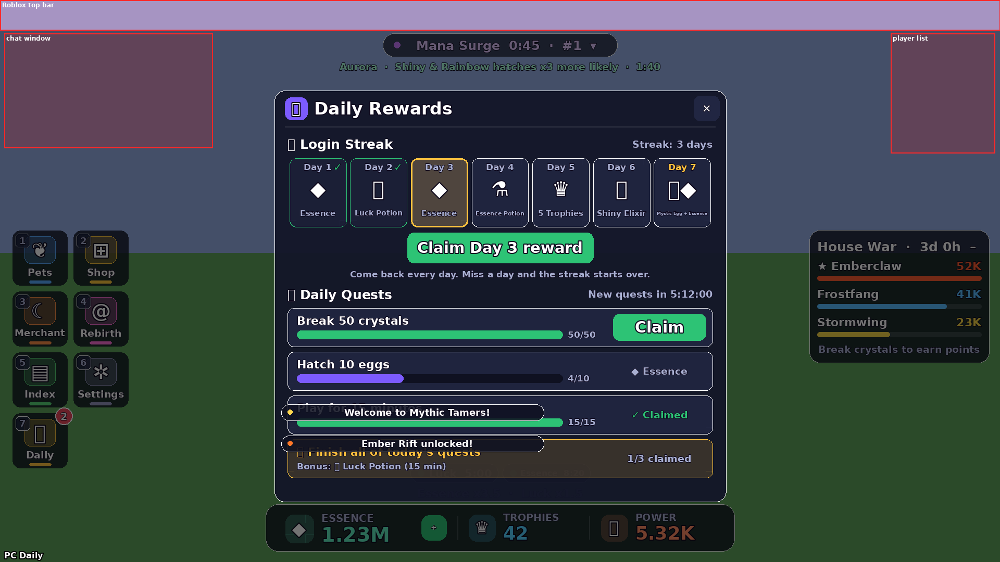

# Mythic Tamers

A Roblox **magical creature simulator** with a competitive layer. Players click mana crystals to earn
Essence, hatch magical creatures from eggs, unlock new realms, rebirth for permanent multipliers, and
compete in server-wide **Mana Surges** and a weekly cross-server **House War**.

- **[docs/GAME_DESIGN.md](docs/GAME_DESIGN.md)**: every system, the economy numbers and the monetization plan
- **[docs/MARKET_RESEARCH.md](docs/MARKET_RESEARCH.md)**: what makes the top simulators different, and which ideas we borrowed
- **[docs/ICONS.md](docs/ICONS.md)**: generated icons for every game pass and product
- **[docs/SOUNDS.md](docs/SOUNDS.md)**: sound effects, music, and how to swap in your own
- **[docs/CREATURE_MESHES.md](docs/CREATURE_MESHES.md)**: 3D models (GLB) of all 25 creatures and how to import them
- **[docs/WORLD_MESHES.md](docs/WORLD_MESHES.md)**: 3D models for eggs, crystals, Mana Chests, the merchant stall and trees, and how to import them

## Look

Everything is built in code from Roblox parts: no mesh uploads needed. The previews below are rendered from the actual
part geometry the game generates.




Real textured 3D meshes for all 25 creatures are also ready to import; see [docs/CREATURE_MESHES.md](docs/CREATURE_MESHES.md).
Built-in creatures animate (wings flap, tails wag, legs paddle, serpents slither), Shiny variants are gold-tinted with sparkles,
Rainbow variants cycle colours, and Champion creatures wear crowns.

## Live sync with Roblox Studio (recommended)

Keep **one** place open in Studio and every change pushed to this repo appears in it automatically.
No more opening new `.rbxl` files.

**One-time setup**
1. Install [Git](https://git-scm.com/downloads) and [Rokit](https://github.com/rojo-rbx/rokit), then in this folder run:
   ```
   git clone https://github.com/jacklukasmith-cloud/roblox.git
   cd roblox
   rokit install
   ```
2. Install the **Rojo** plugin in Studio (Creator Store → search "Rojo", or run `rojo plugin install`).
3. Open your place in Studio (or a blank Baseplate), then **File → Publish to Roblox** so saving and imports work.

**Every session**
1. Start the sync script and leave it running:
   - Windows: `powershell -ExecutionPolicy Bypass -File scripts\sync.ps1`
   - Mac/Linux: `./scripts/sync.sh`
2. In Studio, open the **Rojo** plugin and click **Connect**.
3. That's it. The script checks for new changes every 15 seconds; Rojo pushes them into Studio within a second or two.
   Press **Play** to test. Save/publish the place as usual (Ctrl+S / Alt+P).

What Rojo controls: the scripts (`ServerScriptService.Server`, `StarterPlayerScripts.Client`, `ReplicatedStorage.Shared`) and
the Lighting settings. Anything else you build in Studio is left alone, including the creature meshes you import into
`ReplicatedStorage.CreatureMeshes`. Edit the scripts here, not in Studio: Rojo overwrites Studio-side script edits.

## UI on every device

The HUD scales to the screen and keeps clear of Roblox's own UI (top bar, chat, player list, mobile thumbstick/jump):
phones get a compact layout with big touch targets, tablets a touch-sized layout, PC/console the full layout.
Controllers: **Y** opens the menu, d-pad to move, **A** to select, **B** to close. PC: keys **1-7** open the menus.

| PC | Phone | Tablet |
|---|---|---|
|  |  |  |

(Previews are generated from the UI code; red boxes mark areas Roblox reserves.)

## Quick start (one-off build)

If you just want a file: `rojo build -o MythicTamers.rbxl`, open it in Studio and press **Play**.
The whole map (hub, 4 zones, crystals, eggs, gates, boards) is generated by code when the game runs.

> To test game passes in Studio without buying them, set `Config.StudioOwnsAllPasses = true` in
> `src/shared/Config.luau`. Turn it back off before publishing.

## Before you publish

1. **Publish the place**, then in *Game Settings → Security* turn on **Enable Studio Access to API Services**
   (needed for saving, leaderboards and the House War).
2. On the [Creator Hub](https://create.roblox.com/) create the **7 game passes** and **4 developer
   products** listed in `src/shared/Config.luau`. Upload the icons from [docs/ICONS.md](docs/ICONS.md).
3. Paste each ID into `Config.GamePasses` / `Config.DevProducts` (`Id = 0` means "not set up", and the shop shows it
   as unavailable). Optionally set `Icon = "rbxassetid://..."` so the shop shows the artwork.
4. Add any co-admins' UserIds to `Config.AdminUserIds` (the place owner is always an admin).

## Admin live events (type in chat)

Broadcast to **every server** at once, like Grow a Garden's "admin abuse" events:

| Command | Effect |
|---|---|
| `!surge` | Start a Mana Surge right now |
| `!weather ManaStorm 10` | Force a weather for N minutes (`Clear`, `Starfall`, `Aurora`, `Eclipse`, `ManaStorm`) |
| `!announce Double luck weekend!` | Message every player |

Testing commands (only affect you; everyone is an admin in Studio):

| Command | Effect |
|---|---|
| `!essence 1000000` | Give yourself Essence |
| `!give EmberFox Shiny` | Add a creature (optional `Shiny` / `Rainbow`) |
| `!giveall` | One of every creature |
| `!hatchtest Phoenix Rainbow` | Play the hatch animation for up to 3 creatures (nothing is added) |
| `!boss` | Spawn a boss raid now (add a realm number, e.g. `!boss 2`) |
| `!seasonend` | End the season now on this server and hand out the rewards (for testing) |

## Daily rewards & quests

The **🎁 Daily** button (top-right, key **7**) opens by itself when a reward is waiting; a red bubble on the
tile counts rewards ready to claim. Days roll over at midnight UTC.

- **7-day login streak:** Essence → Luck Potion → Essence → Essence Potion → 5 Trophies → Shiny
  Elixir → **Mystic Egg + big Essence**, then the cycle repeats. Miss a day and it starts over.
- **3 daily quests** (same for everyone that day), e.g. "Break 50 crystals", "Hatch 10 eggs",
  "Open 2 Mana Chests". Each pays Essence; finishing all three unlocks a bonus Luck Potion.



Rewards and the quest pool live in `src/shared/Daily.luau`; Essence rewards scale with your best zone.

## Project layout

```
src/
  shared/            ReplicatedStorage.Shared: data & pure logic used by both sides
    Config.luau      ← all balance numbers + game pass / product IDs
    Creatures.luau   creatures, rarities, Shiny/Rainbow variants
    CreatureModels.luau  procedural 3D creature models + animation + UI viewports
    Eggs.luau        eggs, drop tables, luck-aware rolling
    Zones.luau       the 4 realms
    Weather.luau     global weather schedule (same in every server)
    Merchant.luau    global restocking shop (same in every server)
    Houses.luau      House War factions
    Format.luau      1.2K / 3.4M number formatting
    Remotes.luau     all RemoteEvents / RemoteFunctions
  server/            ServerScriptService.Server
    Main.server.luau boot + remote handlers
    Services/        PlayerData, Economy, Crystals, Hatching, Surge, HouseWar,
                     Monetization, Leaderboards, WorldService, WorldBuilder, Admin
  client/            StarterPlayerScripts.Client
    Main.client.luau boot, gates, VIP chat tag
    Modules/         Ui toolkit, Hud, Panels, Followers, Ambient (spin/bob/squish), State
```

Format code with `stylua src`.
